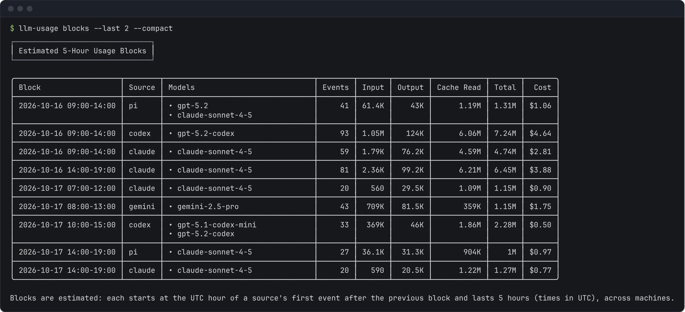

Subscription plans such as Claude Max and ChatGPT Pro meter usage in rolling windows of about five hours. `llm-usage blocks` estimates those windows from your logs, one chain per source, and shows how much each window used and how fast the current one is burning. On a pay-as-you-go API key the blocks mean nothing; use [Usage totals](/llm-usage-metrics/usage/) instead.

```bash
llm-usage blocks
llm-usage blocks --source claude --last 1
```

## How blocks are placed

A block starts at the UTC hour of a source's first event and lasts five hours. The next event of that source at or after the block's end starts the next block. Each source has its own chain, so Claude Code and Codex blocks overlap freely, and one source's chain spans all your [machines](/llm-usage-metrics/machines/), since the provider counts the account, not the computer.

These are estimates. Providers do not write their windows into the logs, and the CLI marks every block report as estimated. A block's start can be off when usage on a day the CLI did not read began the chain earlier; JSON marks such blocks `startUncertain: true`.

## Read the report

The table has one row per block, in time order: the block's start and end in the reporting timezone, the source, models, events, the token columns, and cost. The block that contains the current time is marked `(active)`. Under the table, each active block gets a line:

```text
Active block (estimated), claude: ends 2026-06-21 15:00, 180 min left, burn rate $0.02/h, 13,100 tokens/h.
```



The burn rate is the block's usage so far divided by the time since it started (at least one minute). When some events in the block have no price, the cost rate is a lower bound.

On a narrow terminal each block is listed as labelled values instead of a table row, and `--compact` abbreviates token counts and leaves out minor columns.

## Set the window

Without date flags, `blocks` covers the last 7 days, counting today. `--last N` covers the last N days, `--since` and `--until` take inclusive dates, and `--all` reports every block. `--last` cannot be combined with the other three, and `--all` cannot be combined with dates.

```bash
llm-usage blocks --last 2
llm-usage blocks --since 2026-06-01 --until 2026-06-07
llm-usage blocks --all --top 5 --json
```

To find where a block running into the window started, the CLI also reads the 7 days before it. A block that ends at or before the start of the window is left out; one that started earlier and runs into the window is kept whole. A window that ended before today has no active block.

`--top N` keeps the N largest blocks across all sources, ranked by cost, or by tokens when any block's cost is incomplete or with `--no-cost`.

## Filters keep the account's windows

Your plan's window runs on all of a source's usage, whatever project or model it was for. So `--repo`, `--model`, and `--provider` do not move the blocks: the CLI places them from the source's whole stream, then counts only the usage that matches the filter. Blocks with no matching usage are left out.

```bash
llm-usage blocks --repo api
llm-usage blocks --source claude --model opus
```

`--machine` works the same way. The blocks are placed from every configured machine's usage, read from the cached copies without refreshing them over ssh, and only the machines you name are counted. A machine whose cache cannot be read shows a warning starting with `Account window (blocks across every machine):`, since the windows were placed without it.

`--source` does narrow the chains, since each source is its own chain.

## Output

`blocks` supports terminal, `--json`, and `--markdown` output, but not `--share`; the [interactive report](/llm-usage-metrics/share/) has a 5-hour blocks chart. `--no-cost` leaves cost out of the table.

```json
{
  "schemaVersion": 1,
  "report": "blocks",
  "data": {
    "estimated": true,
    "blockHours": 5,
    "timezone": "UTC",
    "since": "2026-06-15",
    "until": null,
    "top": null,
    "blockCount": 8,
    "blocks": [
      {
        "source": "claude",
        "start": "2026-06-21T10:00:00.000Z",
        "end": "2026-06-21T15:00:00.000Z",
        "startUncertain": false,
        "firstEventAt": "2026-06-21T10:15:00.000Z",
        "lastEventAt": "2026-06-21T10:15:00.000Z",
        "eventCount": 1,
        "inputTokens": 5000,
        "outputTokens": 1200,
        "reasoningTokens": 0,
        "cacheReadTokens": 20000,
        "cacheWriteTokens": 0,
        "totalTokens": 26200,
        "costUsd": 0.039,
        "models": ["claude-sonnet-4-5"],
        "modelBreakdown": [
          {
            "model": "claude-sonnet-4-5",
            "inputTokens": 5000,
            "outputTokens": 1200,
            "reasoningTokens": 0,
            "cacheReadTokens": 20000,
            "cacheWriteTokens": 0,
            "totalTokens": 26200,
            "costUsd": 0.039
          }
        ],
        "active": {
          "remainingMinutes": 180,
          "tokensPerHour": 13100,
          "costUsdPerHour": 0.0195
        }
      }
    ],
    "activeBlocks": []
  }
}
```

The sample keeps one of the eight blocks and leaves `activeBlocks` empty to save space. `blocks` holds the shown blocks, in time order or by rank with `--top`; `blockCount` counts the window's blocks before `--top`. `activeBlocks` repeats the blocks that contain the current time, whether or not `--top` shows them. `active` is `null` on every other block. The full contract is [report-blocks.v1.schema.json](https://ayagmar.github.io/llm-usage-metrics/report-blocks.v1.schema.json).
