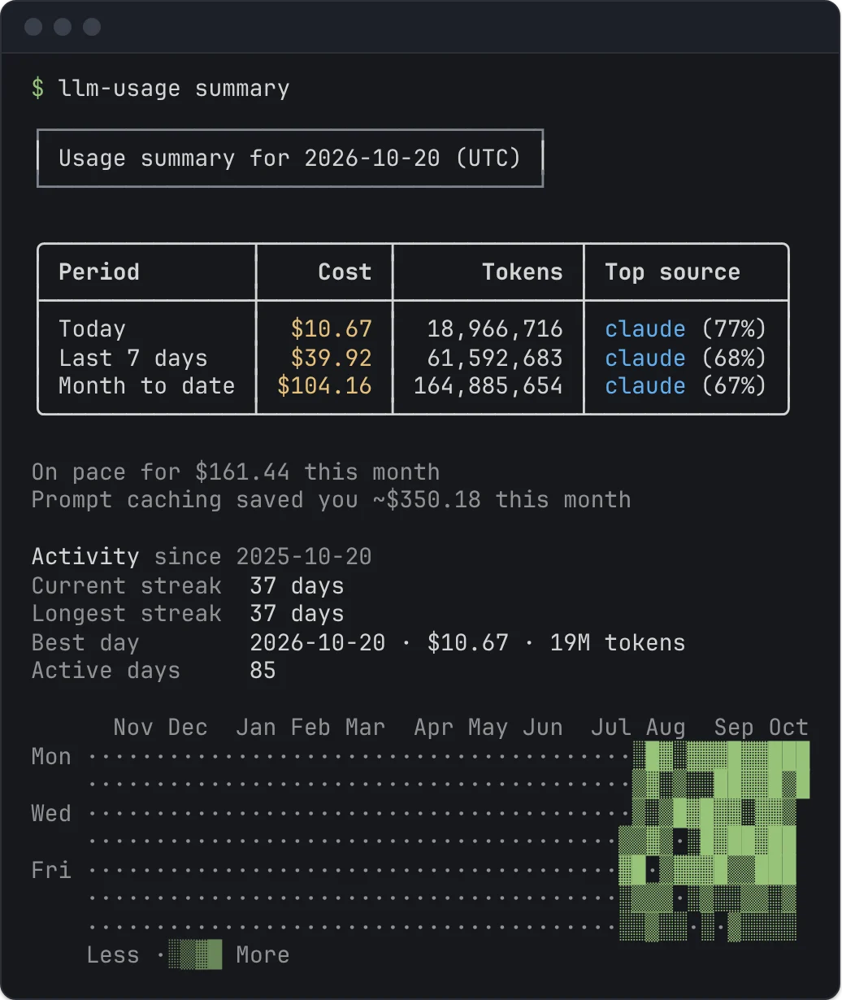
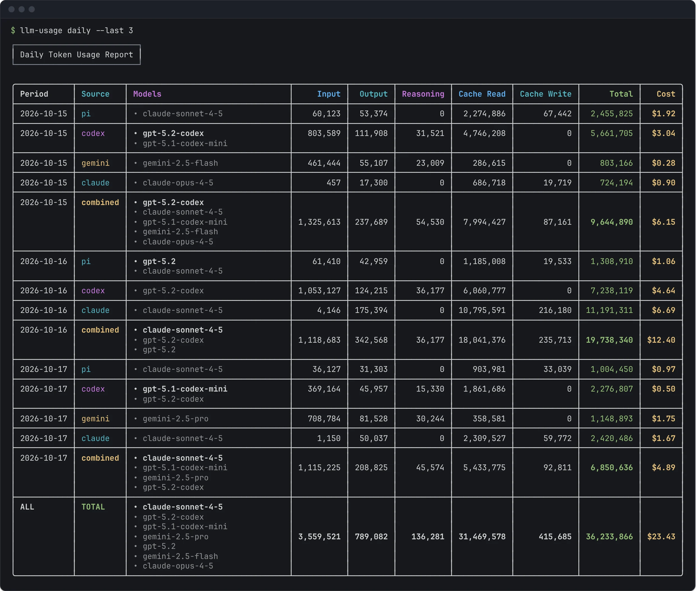

Use `hourly`, `daily`, `weekly`, and `monthly` to group matching usage by period and source. These commands differ in their time buckets; they share filters, pricing, and output formats.

```bash
llm-usage hourly
llm-usage daily
llm-usage weekly
llm-usage monthly
```

Run `llm-usage` with no command for a short summary: cost, tokens, and the top source for today, the last 7 days, and month to date. It accepts the same source, provider, model, project, timezone, pricing, and output flags, but no date flags: `llm-usage summary --since 2026-01-01` fails and points you to `daily`.

Under the table, from the third day of the month, the summary projects the month: month-to-date cost divided by the days so far, times the days in the month ("On pace for $X this month"). Set `monthlyBudgetUsd` in the [config file](/llm-usage-metrics/configuration/) to compare against a budget: the summary says when you are within it, warns when the projection exceeds it, and warns when month-to-date spending already has. The budget covers all your usage, so a run narrowed with `--source`, `--provider`, or `--model` shows the projection without the budget; a `sources` list in the config file keeps it. It also estimates what prompt caching saved this month: cache-read tokens priced at each model's input rate minus its cache-read rate. `--json` carries these under `monthEnd` and `monthToDateCacheSavingsUsd`. When this month counts usage from more than one [machine](/llm-usage-metrics/machines/), it also splits the month's cost by machine (by tokens when the cost is unknown), and `--json` lists each period's machines under `machines`.

Below that, the summary shows your activity over the past year: the current streak, the longest streak, the best day (most tokens), the number of active days, and a heatmap with one column per week and one row per weekday. A streak counts consecutive local days with usage in your reporting timezone; today without usage yet does not break it. The year starts on the Monday 52 weeks before the current week, and a narrow terminal keeps only the most recent weeks that fit. `--json` carries the same data under `activity`, including every day with its intensity level.



## Set the reporting window

Without date bounds, `hourly` covers today, `daily` covers the last 7 days and `weekly` covers the last 8 weeks (from the Monday 7 weeks before the current week), both in your reporting timezone. Each prints a reminder on `stderr`; `--all` includes every period and cannot be combined with `--since` or `--until`. `monthly` includes all matching discovered history and does not limit the result to the current month.

```bash
llm-usage daily --all
llm-usage weekly --all
```

```bash
llm-usage monthly --since 2026-09-01 --until 2026-09-30
```

`--last N` covers the last N days, weeks, or months, counting the current one: `daily --last 1` is today, `weekly --last 1` is this week, and `monthly --last 3` is this month and the two before it. For `hourly`, N counts days and goes up to 31. The window ends today, so usage dated later (from a clock set ahead) is left out. It cannot be combined with `--since`, `--until`, or `--all`.

```bash
llm-usage weekly --last 1
llm-usage monthly --last 3
```

`--since` and `--until` use inclusive calendar dates in the reporting timezone. Set `--timezone` to keep boundaries consistent across machines:

```bash
llm-usage daily --timezone UTC --since 2026-09-01 --until 2026-09-07
```

## Hour by hour

```bash
llm-usage hourly --last 3
llm-usage hourly --since 2026-06-15 --until 2026-06-15 --by-repo
```

`hourly` labels each row with the local hour it starts (`2026-06-15 09:00`) in the reporting timezone and prints a reminder on `stderr` when it shows today by default. It has no `--all` and no `--share`. When the clocks go back at the end of daylight saving time, one local hour happens twice; its row covers both, a note on `stderr` names it, and the JSON row carries `repeatedHour: true`.

Use [Compare](/llm-usage-metrics/compare/) when you want a current-versus-baseline comparison instead of a sequence of period totals.

## Narrow the scope

```bash
# Tool that wrote the session
llm-usage monthly --source codex,claude

# Normalized billing provider
llm-usage monthly --provider openai

# Model name or substring
llm-usage monthly --model codex
```

Source and provider are different: a Codex event can have `source=codex` and `provider=openai`. Model filters use an exact match when one exists after source, provider, and date filtering; otherwise they use substring matching.

A filter that cannot match prints a warning on `stderr`, with a suggestion for a likely typo: a `--model` or `--provider` value that appears in no usage within the report's dates (`--model claude-opsu-5-5 matched no usage in this date range (did you mean claude-opus-5-5?)`), or a `--source` that has no files. A `sources` list in the config file never warns. An unknown `--source` id is an error that also suggests the closest id.

`--repo` keeps the usage of some projects only. A path (absolute, or starting with `./`, `../`, or `~/`) matches that project and the projects under it; a name or path tail such as `api` or `work/api` matches the end of a project's path; `(unattributed)` matches usage without one. [Projects](/llm-usage-metrics/projects/) explains where a project comes from. `--machine` counts only the [machines](/llm-usage-metrics/machines/) you name (`local` is this one).

```bash
llm-usage monthly --repo work/api
llm-usage daily --machine local
```

For custom session locations, use [source path overrides](/llm-usage-metrics/sources/#override-a-location). Save recurring defaults in [Configuration](/llm-usage-metrics/configuration/).

## Read the rows

A period has a row for each contributing source. A `combined` row appears when multiple sources contribute to that period. The final `ALL` row totals the full filtered range.



`--by-repo` splits each source row by project (`claude · api`), and `--by-machine` by the machine the usage came from; the two can be combined. In `--json`, the split rows carry `repoRoot` and `machine`.

Token columns preserve the normalized buckets provided by each adapter: input, output, reasoning, cache read, cache write, and total. Reasoning can be included in output for some sources, so adding every displayed bucket is not a reliable way to reconstruct total tokens. Check the [source guide](/llm-usage-metrics/sources/) for token semantics.

Cost is in USD:

| Display   | Meaning                                           |
| --------- | ------------------------------------------------- |
| `$12.34`  | Every contributing event has resolved cost.       |
| `~$12.34` | Only some contributing events have resolved cost. |
| `-`       | No contributing event has resolved cost.          |

A resolved cost may be source-recorded or estimated. It is not a guarantee that the amount matches your invoice. [Pricing](/llm-usage-metrics/pricing/) explains rate matching, offline mode, and overrides.

## Inspect model breakdowns

```bash
llm-usage monthly --per-model-columns
```

This expands metrics into aligned multiline cells ranked by each model's total tokens within the row. It works with terminal and Markdown output.

## Fit narrow terminals

Tables shrink to the terminal width: token counts are abbreviated first, then less-used columns are hidden, and a note on `stderr` says what was left out. On a terminal too narrow for any table, such as a phone, each row is listed as labelled values instead. `--compact` asks for the short table directly; see [Output formats](/llm-usage-metrics/output-formats/). Use [Session usage](/llm-usage-metrics/session/) when you need conversations or repositories instead of time buckets.

## Export or share

```bash
llm-usage monthly --json > usage.json
llm-usage monthly --markdown > usage.md
llm-usage monthly --share
```

JSON uses the `usage` report envelope for all four granularities. `--share` writes an interactive `usage-monthly-share.html` report to the current directory, opens it in your browser, and still prints the normal report; daily and weekly write `usage-daily-share.html` and `usage-weekly-share.html`. `llm-usage summary --share` writes `summary-share.html`, which opens on the past 53 weeks. `hourly` has no `--share`; the share report has its own hour view. See [Interactive report](/llm-usage-metrics/share/) for what the page offers and [Output formats](/llm-usage-metrics/output-formats/) for contracts and diagnostics.

## Retained history

Reports include retained events from files that have left the disk, with moved or copied files suppressed to avoid duplicate history. A `History:` line on `stderr` says how many departed files it added, when there are any. Leave them out with `--no-history`:

```bash
llm-usage monthly --no-history
```

History needs the event ledger. When the ledger is disabled or cannot be opened, reports run without it; pass `--history` to fail instead. A source pointed at a custom directory (`--codex-dir ./export`, `--source-dir`) gets no history unless you pass `--history`, so departed files never leak into a report scoped elsewhere. The reverse holds too: a file only ever read through a directory flag never shows up as history in a report on the usual location, even after the export is deleted. Directories set in `config.toml` or through variables such as `CODEX_HOME` are the usual location. Files an older version stored from a custom directory still count as history once they are gone. `llm-usage prune --departed-before` can remove them, but it selects every departed file older than the date, including real history, so preview without `--apply` and check the listed paths first. Read [Caching and history](/llm-usage-metrics/caching/) before deleting the ledger or pruning retained events.
